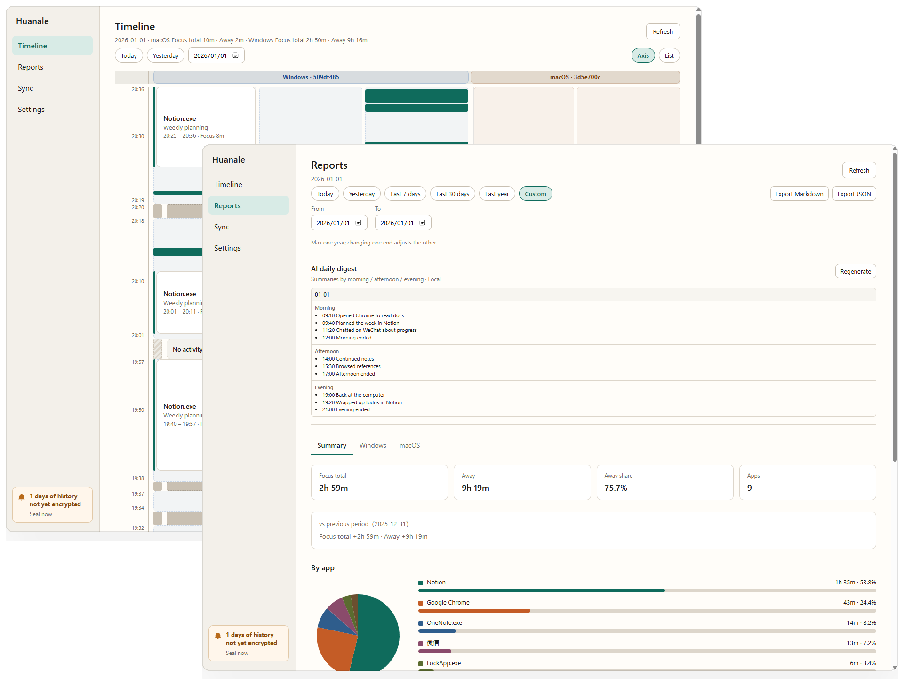
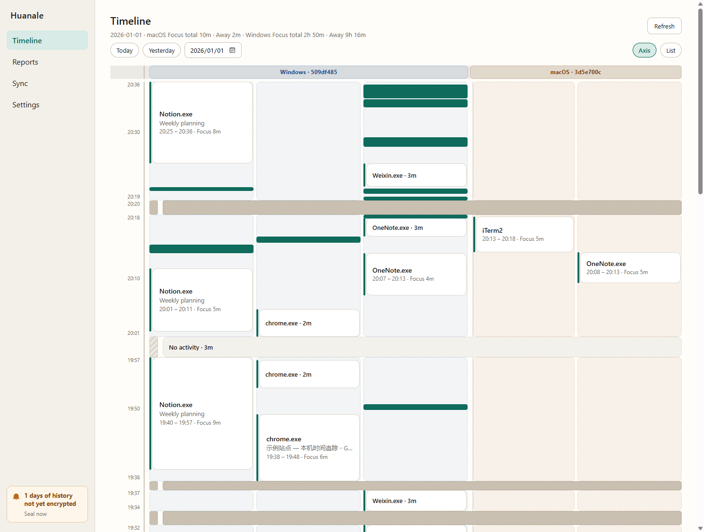
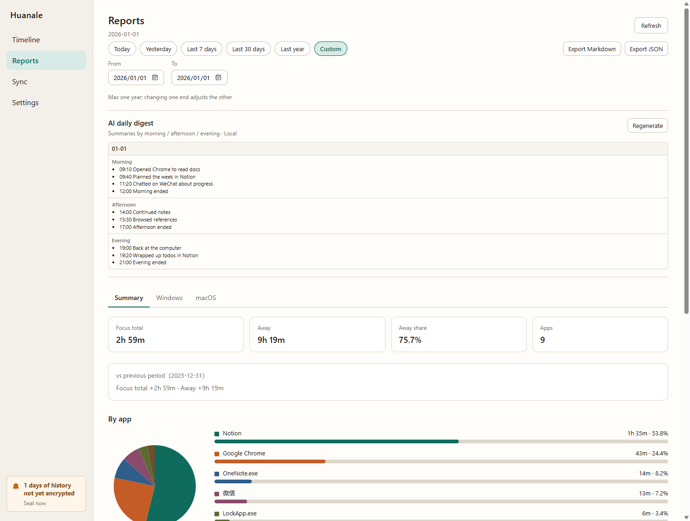
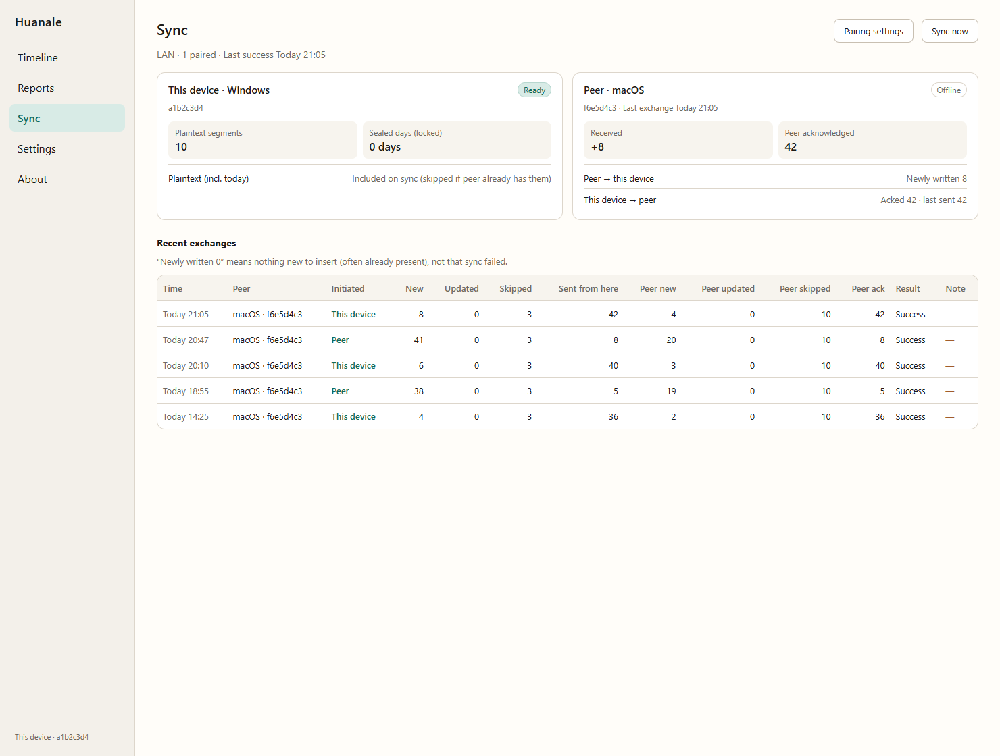
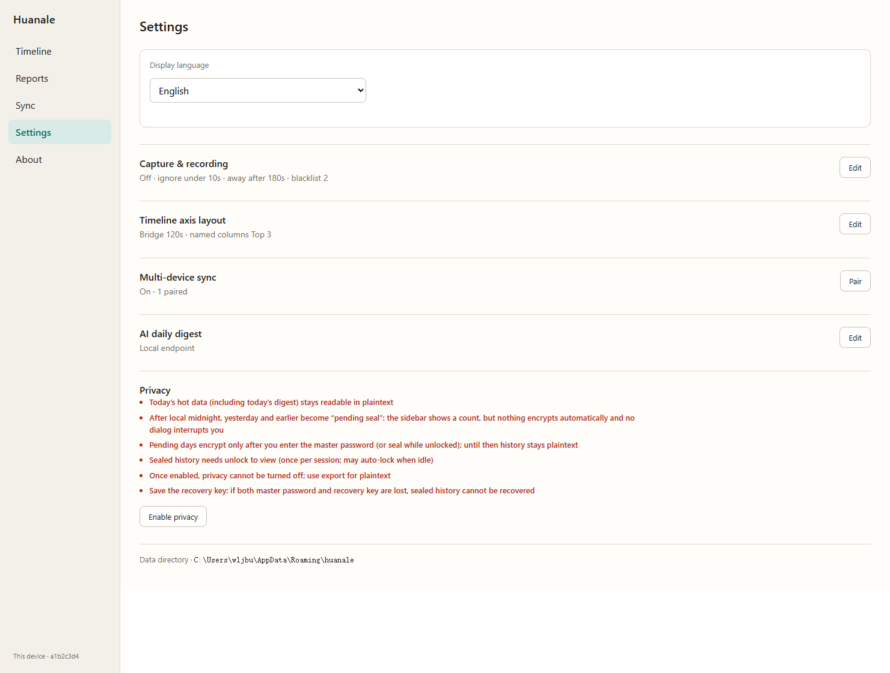

<p align="center">
  
</p>

<h1 align="center">花哪了</h1>

<p align="center">
  <strong>See where your time goes</strong><br />
  Local-first time tracking for Windows and macOS — no account, nothing sent to the cloud by default.
</p>

<p align="center">
  <a href="https://huanale.app">Website</a> ·
  <a href="https://github.com/wljgit/huanalesite/releases">Releases</a> ·
  <a href="https://github.com/wljgit/huanalesite/issues">Issues</a> ·
  <a href="#install">Install</a> ·
  <a href="#quickstart">Quickstart</a> ·
  <a href="#timeline">Timeline</a> ·
  <a href="#reports">Reports</a> ·
  <a href="#sync">Sync</a> ·
  <a href="#settings">Settings</a> ·
  <a href="#privacy">Privacy</a>
</p>

<p align="center">
  <a href="README.md">English</a> ·
  <a href="README.zh.md">中文</a>
</p>

---

<p align="center">
  
</p>

> *If you keep a journal, or just want to know what you actually did at the computer — you used to have to log it by hand. 花哪了 records apps on your machine automatically, so you can look back and see where the time went. Data stays on your computer — no account, nothing sent to the cloud by default.*

## Install

Product site: [huanale.app](https://huanale.app). Installers are not published yet. When they are ready, download from [Releases](https://github.com/wljgit/huanalesite/releases).

### Windows

<!-- TODO: link the Windows installer asset when available -->

_Coming soon — Windows installer (`.exe` / `.msi`)._

### macOS

<!-- TODO: link the macOS installer asset when available -->

_Coming soon — macOS installer (`.dmg`)._

> **Note:** Until packages are code-signed / notarized, Windows SmartScreen or macOS Gatekeeper may warn about an unknown publisher. Confirm the file comes from this repo's Releases before continuing.
>
> On macOS, grant **Accessibility** when prompted (or later in Settings) so window titles can be captured. Without it, the app still records the foreground app and idle / away, but titles may be empty.

## Quickstart

1. **Install and open** 花哪了. It lives in the system tray; no account. Tray right-click can **pause / resume capture** (paused = grey icon).
2. **Use your computer as usual.** About every 1.5s it samples the foreground app, window title, and idle state, then merges short switches into activity segments on this machine only.
3. **Open Timeline** — pick a day, switch between the vertical axis and the list.
4. **Open Reports** — pick a range, read rule-based totals; optionally generate an AI digest if a model is configured.
5. **Optional:** pair another computer under Settings → Sync, then use the Sync page to watch status and run “Sync now”.

<p align="center">
  
</p>

## Timeline

Sidebar: **Timeline**. Browse one local calendar day at a time (today / yesterday / pick a date). The page refreshes about every 5 seconds.

Two views of the same day:

| View | What you get |
|------|----------------|
| **Axis** | Vertical timeline, newest at the top. Block height follows duration; gaps ≥ ~30 minutes and long away stretches fold with a label. Per device, the top **K** apps by foreground time get their own **lanes** (default 3; see Settings); the rest go into Other. Hover short blocks for a tooltip; click to highlight every segment of the same app (or Away) for that day. |
| **List** | Same segments as a reverse-chronological list, with more detail and a **Device** column (`Windows` / `macOS`). |

**Multi-device days:** if more than one machine contributed, the header splits totals per device, and the axis uses separate lane groups with platform-tinted backgrounds — overlapping time on two computers is shown as two stretches, not merged into one. This machine’s lane group stays first.

**Notes & delete:**

- Right-click an app block on the axis to **add a note** (stored locally; not synced in v1).
- Right-click to **delete** stored segments (in-progress ones cannot). In the list, select rows (Shift / select-all) and delete the selection. Deletes stay on this machine — they are not pushed to peers.

Display is minute-oriented (duration copy rounds to minutes; `<1m` for under a minute). Capture still stores seconds underneath.

## Reports

Sidebar: **Reports**. Totals are **rule-based** — no model required.

### Range filters

Pick one of:

- Today / Yesterday  
- Last 7 days / Last 30 days / Last 1 year  
- **Custom** start–end (inclusive, max 365 days)

### What’s in a report

- Duration and share **per app** (pie + bar list; apps under 1 minute of foreground are hidden from the chart and shares are recalculated)
- Hourly distribution, away share, comparison vs the previous equal-length period
- Window-title Top 10  
- Export Markdown / JSON into the app data folder (`exports/`)

### Platform / device tabs

When the range covers activity from **more than one device** (or more than one platform, e.g. Windows + macOS):

- Tabs appear: **Summary** + one tab per platform (or per device if several machines share a platform, labeled like `Windows · abcdefgh`)
- **Summary** adds durations across devices (app names normalized where possible)
- Platform / device tabs keep per-machine numbers as stored  
- A single-device range hides the tabs

**AI digest** (optional) sits on the same page: morning / afternoon / evening bullets for each day in the range. It always looks at the whole selected range and is **not** filtered by the platform tab. Configure a provider in Settings first (off / local OpenAI-compatible / DeepSeek). Prefer a local model; a remote API sends usage data to that provider. You can fill missing days, regenerate the whole range, or cancel mid-run.

<p align="center">
  
</p>

## Sync

Sidebar: **Sync** (status) · pairing lives under **Settings**.

v1 is **LAN only** (same local network). Cloudflare fallback is planned later. Your local database stays the source of truth; sync exchanges encrypted activity segments between paired machines.

### Pairing (do this once per peer)

On **both** computers, open **Settings → Sync** and use either method (same payload underneath):

1. **Short code** — one side shows an 8-digit code; type it on the other within **10 minutes** (5 failed attempts lock the attempt). The code only proves you are at the pairing machine; it does not carry the sync key by itself.
2. **Pair string / QR text** — copy a string like `huanale-pair:1:…` (or the text inside the QR). Desktop does not open a camera; paste the string on the other machine.

After pairing, both sides share a **Sync DEK** in the OS keychain. You do not set a separate “sync password”. You cannot pair a machine with itself. If a peer is already stored with a different Sync DEK, the app refuses to overwrite it.

### Sync page

After pairing and enabling sync:

- See how many local segments are ready to send, and any sealed history still locked
- Peer online / last exchange / what you received / what the peer confirmed
- Roughly the last **30** exchange log lines (per peer: platform + short device id)
- **Sync now** — try once with every paired peer visible on the LAN (one log line each)

With sync on, the app also exchanges about every **20 minutes** when peers are reachable. Guest Wi‑Fi client isolation, sleep, or firewalls can block discovery — that is expected on LAN v1. Deleting a segment on one machine does **not** remove it from peers in v1.

<p align="center">
  
</p>

## Settings

Sidebar: **Settings**. Main groups:

| Area | What you can set |
|------|------------------|
| **Language** | `中文` / English (tray text follows) |
| **Capture** | On/off (also via tray); minimum foreground stay; idle threshold before Away; **app blacklist** (exact name match after dropping `.exe`, case-insensitive — list right-click can add). On macOS: Accessibility status, open System Settings, re-prompt |
| **Timeline display** | Same-app lane bridge window (default 120s); named-lane **Top-K** (default 3, range 1–4) — display only, does not change stored segments or reports |
| **Sync** | Enable sync; start / join pairing (short code or pair string). Status and “Sync now” are on the Sync page |
| **Privacy** | Optional day-seal protection (main password + recovery key). Once enabled, it cannot be turned off — see [Privacy](#privacy) |
| **AI digest** | Off / local OpenAI-compatible endpoint / DeepSeek; endpoint & key; whether to send window titles |
| **Data** | Show the local data directory path |

Sidebar also has **About** (version, copyright, open full EULA).

Not in the product yet: “don’t record titles” as a capture toggle, launch at login.

Data folders:

- Windows: `%APPDATA%/huanale/`
- macOS: `~/Library/Application Support/huanale/`

<p align="center">
  
</p>

## Privacy

Defaults: no account, activity stays in local SQLite, nothing uploaded for normal use.

| | |
|---|---|
| **Captured** | Foreground app, window title, duration, idle / away |
| **Not captured** | App internals (document / page body), clipboard, screenshots, keystrokes |
| **Optional seal** | After local midnight, past days can be encrypted once you unlock (activity, digests, and notes); today stays plaintext while “hot”. Idle auto-lock (default 5 minutes) after unlock |
| **Sync** | Paired LAN exchange is encrypted with the Sync DEK; separate from the local seal password |
| **AI** | Only if you configure a third-party remote model — then usage data for digest goes to that provider |

## FAQ

**Do I need an account?**  
No.

**Is my data uploaded?**  
Not by default. Related data leaves the device only if you configure a third-party remote model for AI digest, or turn on multi-device sync; a local model with sync off does not send it out.

**Which platforms?**  
Windows and macOS desktops. No mobile app.

**Does the OS block the installer?**  
It might until packages are signed / widely recognized. Use files from this repo’s [Releases](https://github.com/wljgit/huanalesite/releases) only.

**Can I sync over the internet?**  
Not yet. v1 is same-LAN only; cloud transport is planned without changing the merge / key model.

## This repository

Public site ([huanale.app](https://huanale.app)), Issues, and installer Releases live here. Desktop app source is private and not linked.

Website local development:

```bash
npm install
npm run dev
npm test
npm run build
```

See [docs/overview.md](docs/overview.md) and [CLAUDE.md](CLAUDE.md) for site docs.
