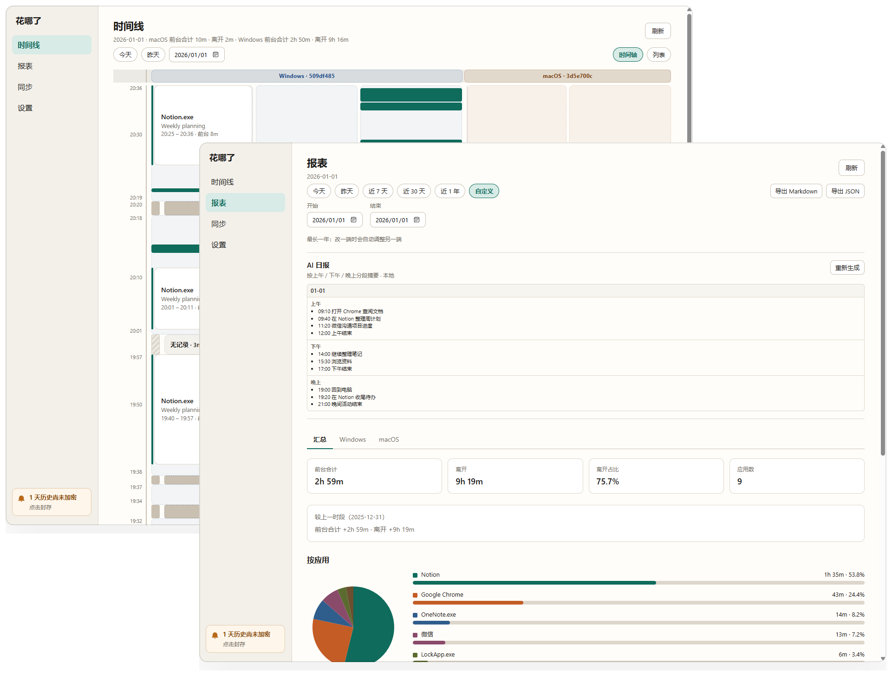
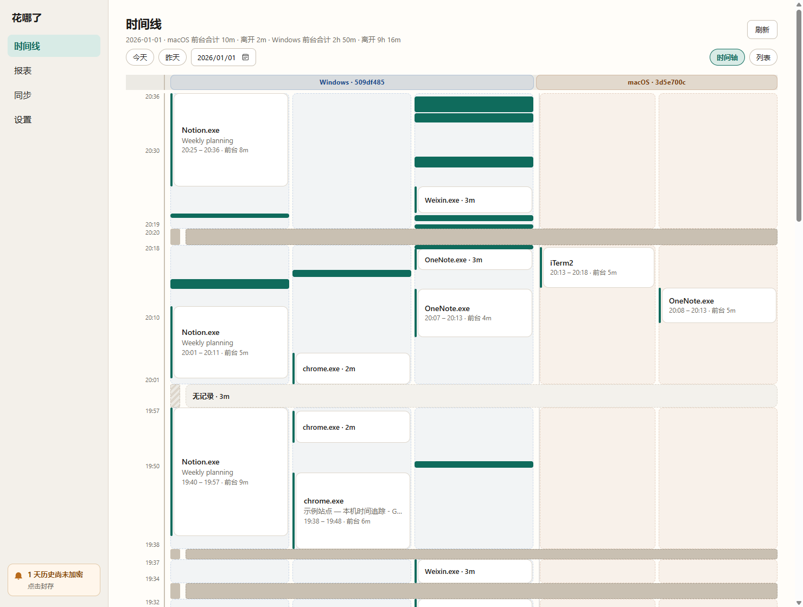
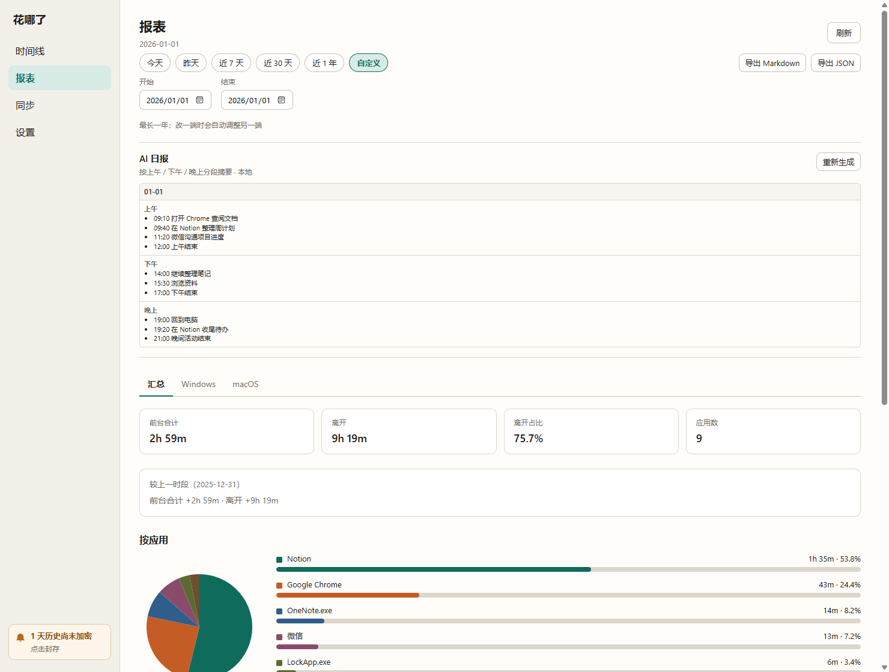
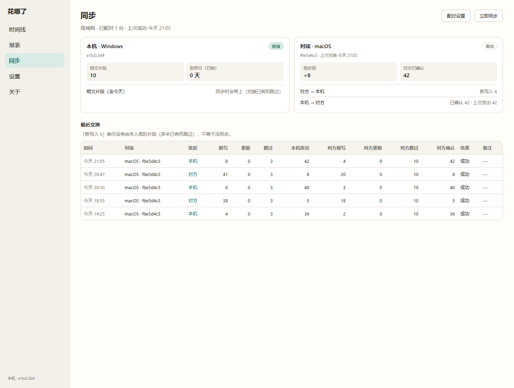
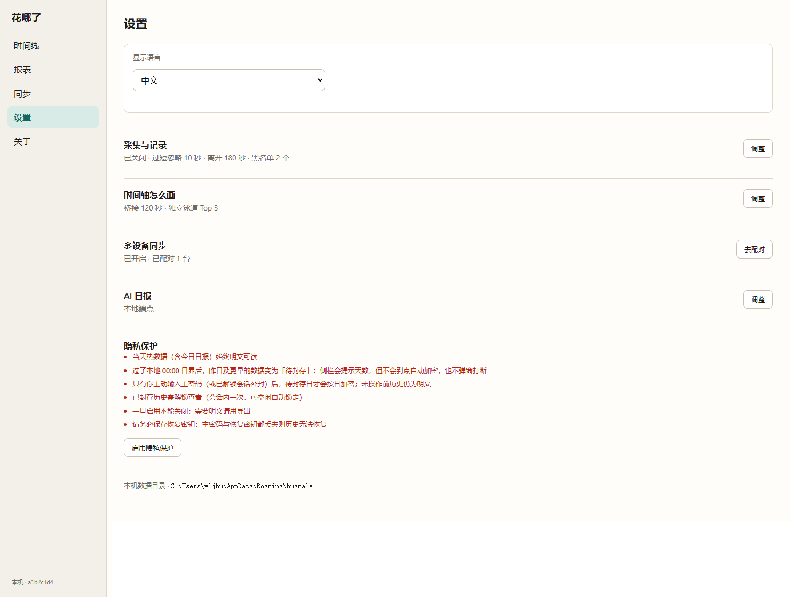

<p align="center">
  
</p>

<h1 align="center">花哪了</h1>

<p align="center">
  <strong>时间花在哪，一眼就看见</strong><br />
  本机优先的时间追踪桌面应用，支持 Windows 与 macOS — 无需账号，默认不上云。
</p>

<p align="center">
  <a href="https://huanale.app">官网</a> ·
  <a href="https://github.com/wljgit/huanalesite/releases">Releases</a> ·
  <a href="https://github.com/wljgit/huanalesite/issues">Issues</a> ·
  <a href="#安装">安装</a> ·
  <a href="#快速开始">快速开始</a> ·
  <a href="#时间线">时间线</a> ·
  <a href="#报表">报表</a> ·
  <a href="#同步">同步</a> ·
  <a href="#设置">设置</a> ·
  <a href="#隐私">隐私</a>
</p>

<p align="center">
  <a href="README.md">English</a> ·
  <a href="README.zh.md">中文</a>
</p>

---

<p align="center">
  
</p>

> *如果你习惯记日志，或总想弄清自己在电脑前到底干了什么——以前往往只能靠手工一条条记。花哪了在本机自动记下用过的应用，打开就能回看时间花在哪。数据始终留在你的电脑，无需账号，默认不进云端。*

## 安装

产品官网：[huanale.app](https://huanale.app)。安装包尚未发布。就绪后请从 [Releases](https://github.com/wljgit/huanalesite/releases) 下载。

### Windows

<!-- TODO: 安装包就绪后补上 Windows 安装包链接 -->

_即将提供 — Windows 安装包（`.exe` / `.msi`）。_

### macOS

<!-- TODO: 安装包就绪后补上 macOS 安装包链接 -->

_即将提供 — macOS 安装包（`.dmg`）。_

> **说明：** 在安装包完成代码签名 / 公证之前，Windows SmartScreen 或 macOS Gatekeeper 可能会提示「未知发布者」。请确认文件来自本仓 Releases 后再继续安装。
>
> macOS 上请按提示授予**辅助功能**权限（也可稍后在设置页处理），以便记录窗口标题。未授权时仍会记前台应用与空闲 / 离开，但标题可能为空。

## 快速开始

1. **安装并打开**花哪了。应用常驻托盘，无需账号。托盘右键可**启用 / 暂停采集**（暂停时图标变灰）。
2. **照常使用电脑。** 大约每 1.5 秒采样前台应用、窗口标题与空闲状态，再合并成活动片段，只写在本机。
3. **打开时间线** — 选一天，在竖直时间轴与列表之间切换。
4. **打开报表** — 选区间看规则汇总；若已配置模型，可在同页生成 AI 日报。
5. **可选：** 在「设置 → 同步」配对另一台电脑，再到侧栏「同步」页查看状态、点「立即同步」。

<p align="center">
  
</p>

## 时间线

侧栏：**时间线**。按本机日历日浏览（今天 / 昨天 / 选日期）。页面大约每 5 秒自动刷新。

同一天有两种视图：

| 视图 | 内容 |
|------|------|
| **时间轴** | 竖直轴，最新在上。块高度按时长拉伸；约 ≥30 分钟的空隙与长离开会折叠并标注。每台设备按当天前台时长取前 **K** 个应用独占**泳道**（默认 3，见设置），其余进「其他」。短块悬停看 tooltip；点击可高亮当天同一应用（或「离开」）的全部片段。 |
| **列表** | 同一批片段的倒序列表，细节更多，并有**设备**列（`Windows` / `macOS`）。 |

**多设备的一天：** 若超过一台机器有记录，顶栏合计按设备分开写；时间轴按设备分组泳道，并用平台底色区分——两台同时在用会保留两条片段，不会并成一条。本机泳道组始终排在最前。

**说明与删除：**

- 时间轴上对应用块右键可**补充说明**（也可改 / 清空）。说明会随局域网同步一起交换（与活动片段同包；也可给对端片段写说明，方便对端做 AI 日报时带上）。删除说明会通过同步 tombstone 传到对端。
- 右键可**删除**已落库片段（进行中的不能删）。列表支持勾选（含 Shift / 全选）后批量删除。删除片段会在下次同步推到对端（revision 抬一档 + 删除标记）；对端更旧的活副本不会把记录写回来。

展示按本地**分钟**对齐（时长文案到分钟，不足 1 分钟为 `<1m`）；底层采集仍按秒存储。

## 报表

侧栏：**报表**。汇总是**规则计算**，不依赖大模型。

### 区间筛选

可选：

- 今天 / 昨天  
- 近 7 天 / 近 30 天 / 近 1 年  
- **自定义**起止日（含端点，跨度最多 365 天）

### 报表里有什么

- 各应用时长与占比（饼图 + 柱状列表；前台不足 1 分钟的应用从图中隐藏，并对剩余项重算占比）
- 按小时分布、离开占比、与上一等长时段对比
- 窗口标题 Top 10  
- 导出 Markdown / JSON 到数据目录下的 `exports/`

### 平台 / 设备 Tab

当所选区间里有 **≥2 台设备**（或 ≥2 个平台，例如 Windows + macOS）有活动时：

- 出现 Tab：**汇总** + 各平台（同平台多台则拆成 `Windows · abcdefgh` 这类设备 Tab）
- **汇总**跨设备加总时长（应用名会尽量做归一）
- 平台 / 设备 Tab 按落库原样分列  
- 只有一台设备时不显示 Tab

同页还有可选的 **AI 日报**：按上午 / 下午 / 晚上生成短 bullet，覆盖所选区间内各天。日报始终看整段所选区间，**不受**平台 Tab 影响。需先在设置里配置提供方（不用 / 本地 OpenAI 兼容端点 / DeepSeek）。更推荐本地模型；第三方远程接口会把使用数据发给对方。支持补全缺失天、整段重新生成、中途取消。

<p align="center">
  
</p>

## 同步

侧栏：**同步**（看状态）· 配对在**设置**里完成。

当前 v1 **仅局域网**（需同一本地网络）。Cloudflare 回退仍在规划。本机数据库仍是真相源；同步在已配对机器之间交换加密后的**活动片段**与**时间轴块说明**。AI 日报在 v1 不同步。

### 配对（每台对端做一次）

在**两台电脑**上都打开 **设置 → 同步**，任选一种方式（底层是同一套载荷）：

1. **短配对码** — 一端显示 8 位数字，另一端在 **10 分钟**内输入（连续失败 5 次会锁定）。**成功配对一次即失效**，再配对需重新生成。短码只证明「你就在正在配对的电脑旁边」，本身不携带同步密钥。
2. **配对串 / 二维码文本** — 复制形如 `huanale-pair:1:…` 的字符串（或二维码里的文本）。桌面端不调摄像头；在另一台粘贴即可。

配对成功后，双方在系统钥匙串中共享同一把 **Sync DEK**。你不需要再设「同步专用密码」。不能和本机配对。若已有同伴且钥匙串里已是另一套 Sync DEK，应用会拒绝改用新密钥。

### 同步页

配对并开启同步之后，这里可以：

- 看本机可同步片段数，以及仍锁定、未发出的封存日范围
- 看对端是否在线、上次交换、我收到多少、对方是否已确认
- 查看大约最近 **30** 条交换日志（按对端：平台 + 短 device id）
- 点 **立即同步** — 尽量与当前局域网内所有已配对且可见的对端各交换一次（每端一条记录）

开启后大约每 **20 分钟**在局域网自动交换一次（对端可达时）。访客 Wi‑Fi 隔离、睡眠、防火墙会导致发现失败——局域网 v1 下这是预期情况。**片段**与**说明**的删除都会同步；AI 日报与多数本机设置不同步。

<p align="center">
  
</p>

## 设置

侧栏：**设置**。主要可配：

| 区块 | 可设置内容 |
|------|------------|
| **显示语言** | 中文 / English（托盘文案随语言更新） |
| **采集** | 开关（也可托盘启停）；最短前台停留；空闲多久算「离开」；**应用黑名单**（去 `.exe`、大小写无关的整串匹配；时间线列表可右键加入）。macOS：辅助功能授权状态、打开系统设置、再次触发授权提示 |
| **时间轴显示** | 同应用泳道桥接秒数（默认 120）；具名泳道 **Top-K**（默认 3，范围 1–4）— 只影响展示，不改落库片段与报表 |
| **同步** | 开启同步；发起 / 加入配对（短码或配对串）。状态与「立即同步」在同步页 |
| **隐私保护** | 可选按日封存（主密码 + 恢复密钥）。一旦启用不可关闭 — 见[隐私](#隐私) |
| **AI 日报** | 不用 / 本地 OpenAI 兼容端点 / DeepSeek；端点与 key；是否发送窗口标题。本地 Base URL **仅允许本机或局域网**（如 `127.0.0.1`、`192.168.x.x`），不能填公网 API |
| **数据** | 展示本机数据目录路径 |

侧栏另有**关于**页（版本、版权、打开完整 EULA）。

尚未提供：采集侧「是否记录标题」开关、开机启动。

数据目录：

- Windows：`%APPDATA%/huanale/`
- macOS：`~/Library/Application Support/huanale/`

<p align="center">
  
</p>

## 隐私

默认：无账号，活动在本机 SQLite，正常使用不上云。

| | |
|---|---|
| **会记** | 前台应用、窗口标题、停留时长、空闲 / 离开 |
| **不记** | 应用内部内容（文档 / 网页正文）、剪贴板、截屏、键鼠输入 |
| **可选封存** | 过本地 00:00 日界后，历史日可在解锁后加密封存（活动、日报与说明）；当天热数据仍明文。解锁后可配空闲自动锁定（默认 5 分钟） |
| **同步** | 已配对的局域网交换（片段 + 说明）用 Sync DEK 加密；与本机封存密码分开 |
| **AI** | 仅当配置了第三方远程模型做日报时，相关使用数据才会发给对方 |

## 常见问题

**需要注册账号吗？**  
不需要。

**数据会上云吗？**  
默认不会。只有配置了第三方远程模型做 AI 日报，或开启多机同步时，相关数据才会按说明离开本机；使用本地模型且不同步则不会外发。

**支持哪些平台？**  
目前支持 Windows 与 macOS 桌面版。没有移动版。

**安装时被系统拦截？**  
有可能，尤其是在安装包尚未签名 / 广泛识别之前。请只用本仓 [Releases](https://github.com/wljgit/huanalesite/releases) 里的文件。

**能异地同步吗？**  
目前不能。v1 仅同局域网；云传输在规划中，合并与密钥模型预计不变。

## 本仓库

本公开仓承载产品官网（[huanale.app](https://huanale.app)）、Issues 与安装包 Releases。桌面应用源码在私有仓，不对外链。

官网本地开发：

```bash
npm install
npm run dev
npm test
npm run build
```

站点文档见 [docs/overview.md](docs/overview.md) 与 [CLAUDE.md](CLAUDE.md)。
